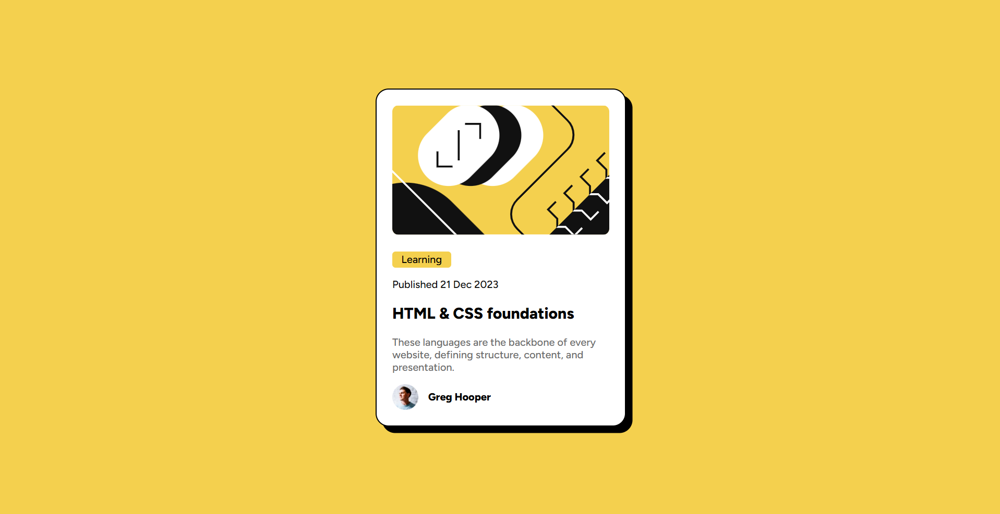

# Frontend Mentor - Blog Preview Card

My solution to the [Blog Preview Card challenge](https://www.frontendmentor.io/challenges/blog-preview-card-ckPaj01IcS) on Frontend Mentor.

## Overview

A responsive blog preview card built using HTML and CSS.

### Screenshot

### Links

- **Live Site:** [View Project](https://98dinesh89.github.io/Frontend-Mentor-Blog-preview-card/)
- **Frontend Mentor Solution:** [98Dinesh89](https://www.frontendmentor.io/profile/98Dinesh89)

## My Process

### Built With

- HTML5
- CSS3
- Flexbox
- Responsive design

### What I Learned

- Using `@font-face` to load local fonts.
- Using Flexbox to center and align elements.
- Making layouts responsive with `width` and `max-width`.
- Using padding, margins, borders, and box shadows to style a card.

### Continued Development

I want to improve my CSS skills and build more responsive layouts while practising HTML and CSS.

## Author

- GitHub: [@98Dinesh89](https://github.com/98Dinesh89)
- Frontend Mentor: [@98Dinesh89](https://www.frontendmentor.io/profile/98Dinesh89)
